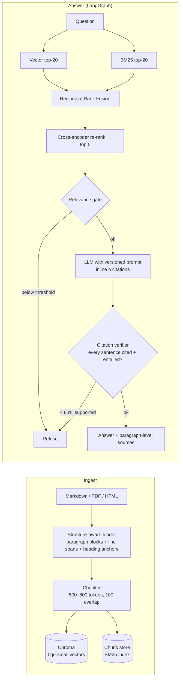

# Ask My Docs — production-grade, citation-enforced RAG

Question answering over the **FastAPI documentation** (tutorial + advanced guide, 86 files, ~71k words)
that answers *only* from retrieved evidence, cites the **exact paragraph** each sentence came from,
refuses when the evidence isn't there, and is guarded by an evaluation suite that runs on every pull request.

Real output from the deterministic `offline` profile (with `--profile default`, Claude writes the
answer and the same verifier checks it):

```
$ askmydocs --profile offline ask "Can I use a wildcard for allow_origins when allow_credentials is True?"

None of `allow_origins`, `allow_methods` and `allow_headers` can be set to `['*']` if
`allow_credentials` is set to `True`. [1] ...

Sources:
  [1] tutorial/cors.md#use-corsmiddleware (L62)
      "None of `allow_origins`, `allow_methods` and `allow_headers` can be set to `['*']` if
      `allow_credentials` is set to `True`. All of them must be explicitly specified ..."

  trace: answer_with_citations@1.2.0#3cb88575e03f | extractive-v1 | lexical-v1 | supported=100%

$ askmydocs --profile offline ask "How do I add Sentry error monitoring to FastAPI?"

I can't answer that from the indexed documentation: the retrieved passages don't contain
enough supporting evidence.

  (refused: model_declined)
```

## Architecture



## How this maps to the three phases

| Phase | What's implemented | Where |
|---|---|---|
| **1. Fundamentals** | Loaders for Markdown (handles FastAPI's admonitions, code includes, `{ #anchor }` headings), PDF and HTML. Token-budgeted chunking (target 600, max 800, 100-token overlap) that prefers H2 boundaries and never splits a sentence. Chroma vector store, top-k retrieval, answers with citations down to file + heading anchor + line range. | `ingest/`, `store.py`, `indexer.py` |
| **2. Production quality** | Hybrid retrieval (BM25 + vectors fused with RRF), identifier-aware tokenizer (`add_task` matches "add task"), cross-encoder re-ranking (or Cohere), a pre-generation relevance gate, post-generation citation enforcement (NLI entailment per sentence, unsupported sentences dropped, refusal below 80% support), prompts in a versioned YAML with a lockfile CI checks. | `retrieval/`, `generation/`, `config/prompts.yaml`, `pipeline.py` |
| **3. Shippable** | 77-item golden set (65 answerable with verbatim evidence spans, 12 unanswerable incl. 5 hard negatives), eval runner measuring retrieval recall/MRR, faithfulness (RAGAS / LLM / NLI judge), citation accuracy, refusal accuracy, latency; thresholds + regression-vs-baseline gates wired into GitHub Actions. | `eval/`, `askmydocs/eval/`, `.github/workflows/ci.yml` |

## Quick start

> Putting it on GitHub, adding your API key and calibrating the real-model gates: see
> [`docs/SETUP.md`](docs/SETUP.md).

```bash
pip install -e ".[dev,api,loaders]"            # core; enough for the offline profile
askmydocs --profile offline ask "How do I override a dependency in tests?"
askmydocs --profile offline eval               # the same gate CI runs

# Full system: bge embeddings, cross-encoder, NLI checks, Claude, RAGAS
pip install -e ".[models,anthropic,ragas]"
export ANTHROPIC_API_KEY=...
askmydocs ingest
askmydocs ask "Why must /users/me be declared before /users/{user_id}?"
askmydocs eval --judge ragas
uvicorn askmydocs.api:app                       # POST /ask {"question": "..."}
```

The index builds itself on first use and rebuilds when the corpus or chunking config changes
(fingerprinted in `.index/<embedder>/manifest.json`); each embedding model gets its own index.

### Profiles

Every model component sits behind an interface, and `config/settings.yaml` defines profiles:

| profile | embeddings | re-ranker | generator | support check | needs |
|---|---|---|---|---|---|
| `offline` | hashing (lexical) | lexical | extractive | lexical | nothing — deterministic |
| `models` | bge-small-en-v1.5 | ms-marco MiniLM cross-encoder | extractive | NLI DeBERTa | model download |
| `default` | bge-small-en-v1.5 | ms-marco MiniLM cross-encoder | Claude | NLI DeBERTa | `ANTHROPIC_API_KEY` |
| `openai` | text-embedding-3-small | cross-encoder | gpt-4o-mini | NLI | `OPENAI_API_KEY` |

The extractive generator obeys the same output contract as the LLM prompt (inline `[n]`, refusal token),
so every guardrail and metric runs, deterministically, in tests and in keyless CI.
Any setting can be overridden by env var: `ASKMYDOCS__RETRIEVAL__RERANK_TOP_N=8`.

## Evaluation

```
askmydocs --profile offline eval
```

| metric | offline profile | what it measures |
|---|---|---|
| retrieval_hit@candidates | 1.000 | gold evidence anywhere in the 20 fused candidates |
| context_recall@k | 0.985 | gold evidence in the 5 chunks the LLM sees |
| mrr@k | 0.842 | how high it ranks |
| answer_rate | 0.892 | answerable questions actually answered |
| refusal_accuracy | 0.750 | unanswerable questions refused (hard negatives: 0.60) |
| faithfulness | 0.983 | answer claims supported by retrieved context (independent judge) |
| citation_doc_accuracy | 0.897 | a cited source is the gold document |
| latency p95 | 0.03 s | end to end, offline backends |

Numbers for the `models` and `default` profiles come from CI (they need model downloads / an API key).
Until a profile has a committed baseline, its CI tier reports metrics without failing; the one-click
**calibrate** workflow writes those baselines and suggests thresholds (see `docs/SETUP.md`).

**Gates** (`eval/thresholds.yaml`): each profile has minimums per metric; on top of that any metric dropping
more than 0.03 below the committed baseline fails the build; and if the faithfulness judge errors on more
than 10% of answers (expired key, rate limit), that fails too rather than silently skipping the metric.
Reports land in `eval/reports/` and in the GitHub Actions job summary, with a table of failing items.

**Golden set integrity** is itself tested: every evidence span must exist verbatim in its document, and
every unanswerable item lists `absent_terms` that must not appear in the corpus. (That test caught five
"unanswerable" questions whose topics *are* mentioned in passing — they're now tagged as hard negatives.)
Edit `scripts/build_golden.py`, not the JSONL.

### Ablation (retrieval only, offline profile)

`python scripts/ablation.py --profile offline`

| variant | hit@1 | recall@5 | MRR@5 |
|---|---|---|---|
| BM25 only | 0.738 | 0.985 | 0.848 |
| Vector only (hashing embedder) | 0.569 | 0.862 | 0.669 |
| Hybrid RRF, no re-rank | 0.646 | 0.938 | 0.760 |
| Vector + re-rank | 0.662 | 0.923 | 0.777 |
| **Hybrid + re-rank (shipped)** | 0.738 | 0.985 | 0.842 |

Read honestly: offline, BM25 alone already matches the shipped pipeline. The offline "vector" retriever is a
hashing embedder, which is lexical, not semantic, and the golden questions were written while reading the docs,
so they share its vocabulary. Plain RRF with a weak second retriever *dilutes* BM25; re-ranking recovers it.
The case for hybrid shows up with real embeddings on paraphrased questions — e.g. *"How can I run some code
after returning a response?"* has no word in common with "Background Tasks" and is the one question the offline
profile misses. Run the ablation under `--profile models` to measure it, and grow the `paraphrase` slice of
the golden set from real user queries.

## Design decisions worth discussing

- **Paragraph-level citations.** Chunks keep each paragraph's line span and heading anchor. The verifier picks
  the paragraph that best supports each sentence, so a citation resolves to `cors.md#use-corsmiddleware (L62)`,
  not "somewhere in this 600-token chunk."
- **Two refusal points.** A cheap gate on re-ranker score before calling the LLM (saves cost on off-topic
  questions), and a post-hoc check that each sentence is entailed by what it cites. The prompt asks the model
  to refuse too, but the system doesn't trust it to.
- **Unseen terms are the most informative.** A first eval run had 25% refusal accuracy. Cause: question terms
  absent from the corpus ("sentry", "slowapi") got a neutral IDF weight, so out-of-scope questions looked well
  covered. Treating unseen terms as maximally rare (`IdfTable`) took it to 58% before any threshold tuning.
- **Prompts are code.** `config/prompts.yaml` is versioned; `config/prompts.lock` stores a content hash per
  prompt, and a test fails if text changes without a version bump. Every answer and report records
  `prompt_id@version#hash`, so a quality change can be traced to the exact prompt.
- **Eval judge ≠ runtime checker.** The runtime verifier decides what users see; eval uses a separate judge
  (RAGAS, an LLM judge, or a stricter threshold offline) so the system isn't grading its own homework.
- **Determinism.** The offline profile gives identical metrics across `PYTHONHASHSEED` values and fresh
  installs, so CI failures mean regressions, not noise. Two bugs were caught getting there: a set-ordering
  tie-break (caught by the regression gate), and a stale index — the index fingerprint covered corpus and
  config but not the chunker *code*, so a chunking change kept serving old chunks locally while a fresh CI
  runner would rebuild. The manifest now also fingerprints the ingestion code and tokenizer.
- **Where the offline profile falls short.** The remaining refusal misses are hard negatives such as
  *"How do I configure GraphQL subscriptions?"*, answered with a tangential sentence about GraphQL using POST.
  A lexical stand-in can't tell "mentions the topic" from "answers the question"; that's the LLM's and the
  NLI verifier's job, and why the `models`/`default` tiers exist.

## Using your own corpus

Point `corpus.paths` in `config/settings.yaml` at your documents (`.md`, `.pdf`, `.html`), update `DOMAIN` in
`pipeline.py`, rewrite `scripts/build_golden.py` with questions about your documents, then
`askmydocs ingest && askmydocs eval --update-baseline`.

## Layout

```
askmydocs/
  ingest/loaders.py      Markdown/PDF/HTML -> paragraph blocks with line spans + anchors
  ingest/chunker.py      token-budgeted, overlap-preserving, structure-aware chunking
  embeddings.py          sentence-transformers | openai | hashing
  store.py, indexer.py   Chroma + chunk store + manifest, staleness detection
  retrieval/             BM25, vector, RRF fusion, cross-encoder/Cohere/lexical re-rankers
  generation/llm.py      Claude | OpenAI | extractive
  generation/citations.py  sentence-level citation verification (NLI or lexical)
  pipeline.py            LangGraph state machine
  eval/                  runner, judges (RAGAS / LLM / NLI / lexical)
  api.py, cli.py
config/settings.yaml, prompts.yaml, prompts.lock
eval/golden.jsonl, thresholds.yaml, baselines/
scripts/build_golden.py, ablation.py, suggest_thresholds.py, fetch_corpus.sh
docs/SETUP.md            GitHub, secrets and calibration, step by step
tests/                   25 tests: chunking, retrieval, guardrails, dataset + prompt integrity
```

Corpus: FastAPI docs at commit `79cab5b`, © Sebastián Ramírez, MIT License (`data/corpus/fastapi/LICENSE`).
